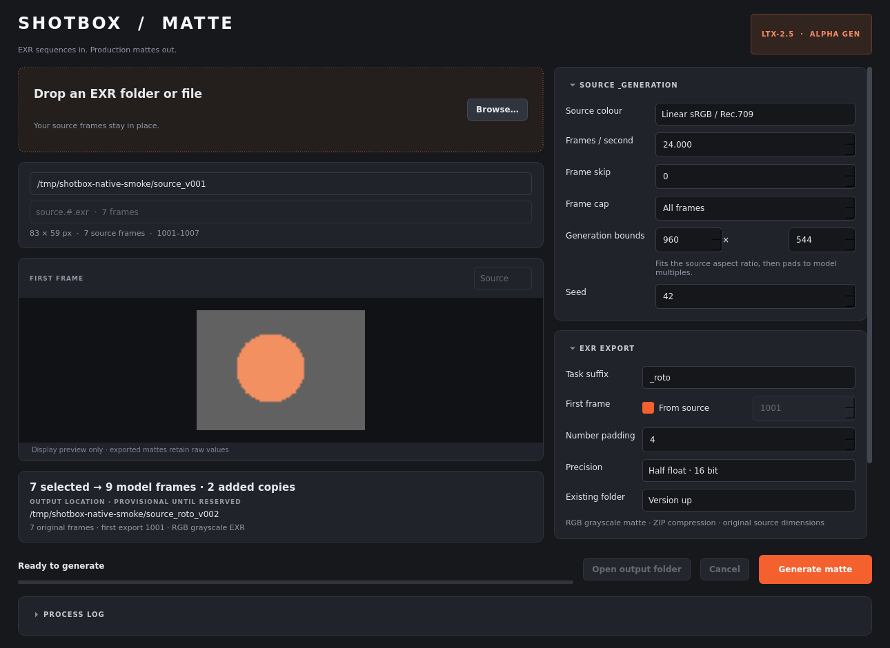
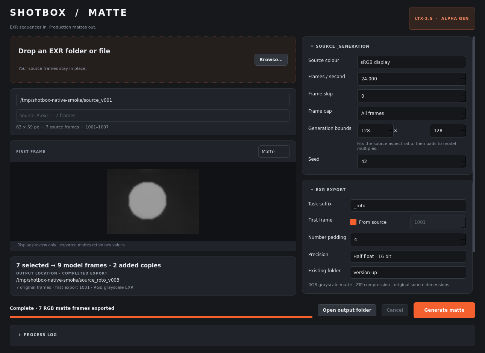
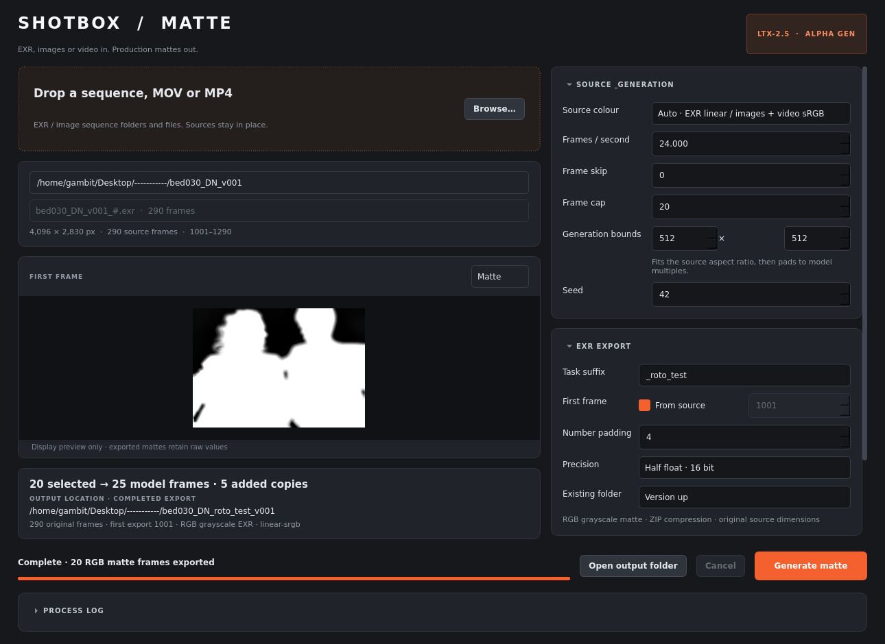
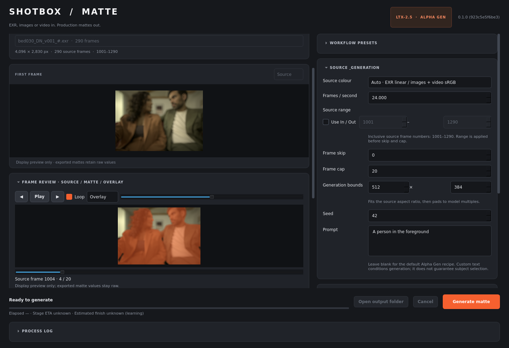
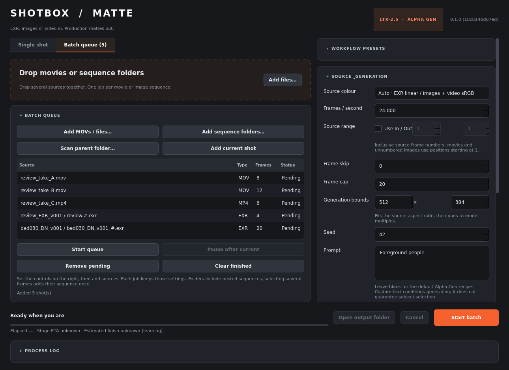
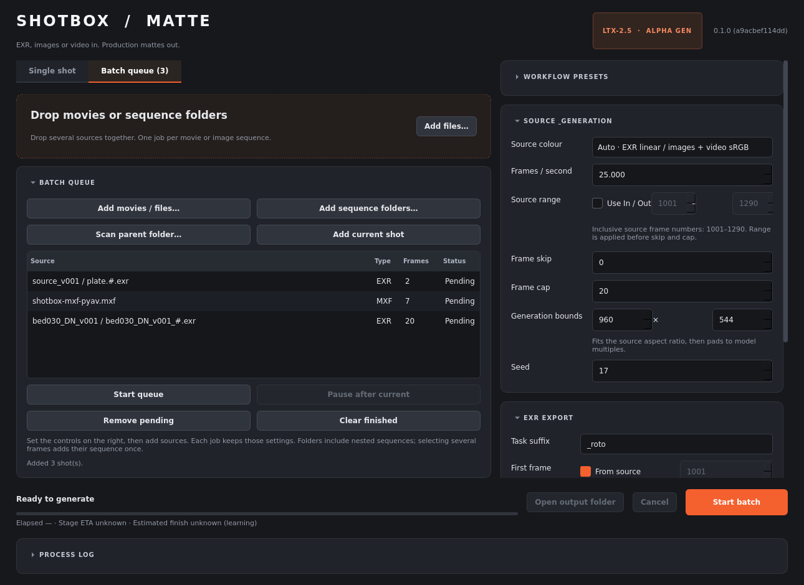

# Verification — 21 October 2026

## Available checks

All **232 tests and 13 subtests passed** on Linux with Python 3.12.13 in the project's `.venv`.
The final suite completed in 12.13 seconds:

```text
.venv/bin/python -m pytest -q
232 passed, 13 subtests passed in 12.13s

.venv/bin/ruff check shotbox_matte tests packaging/windows windows_bootstrap.py build_windows.py launch_ui.py
All checks passed!

.venv/bin/python -m compileall -q shotbox_matte
Exit 0

uv pip check --python .venv/bin/python
All installed packages are compatible
```

The checks cover:

| Area | Evidence |
| --- | --- |
| Sequence discovery | Natural ordering, mixed sequences, file-based selection, duplicate-number rejection, skip and cap |
| Temporal preparation | Valid `8n+1` counts, last-frame repetition, trimming, rejection above model limits |
| Spatial preparation | Aspect-preserving fit, centered edge padding, padding removal and original-size restoration |
| Colour and EXR | Real OIIO half/float ZIP files, RGB channel metadata, linear/display preparation, unclipped float values including −0.25 and 1.25 |
| Version reservation | Concurrent unique versions, next-higher matching version, shared locks, broken-symlink handling |
| Overwrite | Existing frames untouched until commit, exact-sequence stale cleanup, unrelated files preserved, rollback on simulated disk failure |
| Cancellation | Cancelled manifests, old overwrite output preserved, native generator cleanup, cancel-file worker exit and real POSIX Ctrl+C handling |
| CLI | Parsing, JSON progress, error exit codes, dry-run without output creation, Qt/torch/LTX imports explicitly blocked in headless planning tests |
| Models | Local-only discovery, missing/corrupt/quantized file errors, native pack metadata and embedded tokenizer validation |
| Native adapter | Controlled doubles check doubled dimensions, fixed empty text conditioning, single-stage selection, raw range mapping, returned geometry, cancellation and fallback-state restoration |
| Desktop | Real PyQt6 offscreen, real EXR load/preview/plan, frame selection, settings, event-loop responsiveness and a separate worker's validation failure |
| New media inputs | Real MP4, 16-bit MOV and PNG sequence decoding; skip/cap selection, automatic colour preparation, movie-based output naming and EXR export with controlled inference |
| MXF inputs | Genuine MPEG-2 4:2:2 and 10-bit DNxHD MXF, unknown frame-count fallback, audio-only OP-Atom rejection, decoder errors, ranges, EXR export, GUI/QC and bulk imports |
| Media restrictions | Supported-extension filters and drag/drop checks, unsupported-file rejection, mixed-sequence detection and ignoring unrelated sidecar files |
| Project model storage | Shared CLI/UI project-local default and migration of earlier external model preferences without resetting other settings |
| Portable Windows packaging | GUI/CLI/worker dispatch, PE validation, modified Python archive rejection, retained DLL-directory handles and worker startup order |
| Portable preferences | Folder-local INI settings and relocated Windows model paths with spaces and Unicode |
| Prompt removal | No desktop/CLI prompt control, legacy preference/preset/worker text discarded, native pipeline forced empty and plan/manifest recipe fixed empty |
| Result folders | Only named matte EXRs committed; separate job manifests/previews; sibling staging; legacy-sidecar archiving; metadata-failure rollback and lock ownership |
| Bulk source import | Real mixed EXR/MOV/MP4 inputs, nested folders, actual multi-directory Qt selection, mixed drops, duplicate prevention, captured settings and batch-only launch |
| Batch queue | Real QProcess workers prove sequential immutable per-shot settings, failure continuation, pause/resume, cancellation and deduplication |
| Source ranges | Inclusive actual image-frame or one-based movie ranges applied before skip/cap; CLI, worker JSON, UI and real image/movie exports |
| Frame review | Real files and Qt prove scrubbing, stepping, playback, source/matte/overlay switching, coverage/opacity math and stale-load protection |
| Workflow presets | Real INI save/apply/delete roundtrips, malformed data handling and retained input/model configuration |
| Timing | Deterministic interleaved stage samples, elapsed time, successful-history persistence and whole-job finish estimates including future decode |
| Diagnostics | Build fingerprints, optional/warning/error distinction, Open Logs, copied raw session logs and exact bytes across split UTF-8 chunks |
| EXR windows | Real half/float exports preserve per-frame data/display origins, overscan, negative coordinates and pixel aspect; changing raster sizes fail clearly |
| Windows updates | Source/portable/update-overlay fingerprints agree; update ZIP preserves settings, models and runtime; supported GUI limits and CLI input dispatch |

Controlled inference doubles make the regression suite small and deterministic;
they do not establish image quality. Model execution was verified separately.

## Real native GPU smoke test

The complete CLI processing backend ran with:

- NVIDIA GeForce RTX 5090, 32 GB VRAM, driver 590.48.01.
- Python 3.12.13; PyTorch 2.11.0+cu130; CUDA runtime 13.0.
- torchvision 0.26.0+cu130, torchaudio 2.11.0+cu130, transformers 5.14.1.
- Native LTX core/pipelines 1.5.0 at revision
  `e98f6d927d83c92ef2be6aec76c8440b19306e39`.
- The six BF16 components then configured for the application, without model
  downloads or ComfyUI imports. They have since been copied into project-local
  `models/` storage; checksum verification is recorded in `models/manifest.json`.
- CPU model offload, tiled reference encoding and automatic diffusion decode
  tiling, using upstream's PyTorch compatibility operations.

Input was seven synthetic display-RGB float EXRs numbered 1001–1007, each
83×59. They fitted to 128×91, then padded to a 128×96 model canvas. Repeating
the last frame produced nine model frames. The native pipeline request was
256×192 with stage two skipped, and returned nine 128×96 frames as expected.

Gemma4 encoded the empty prompt, the native VAE encoded the RGB conditioning,
the distilled transformer and Alpha Gen LoRA performed all eight denoising
steps, and the diffusion VAE decoded raw floating-point pixels. The backend
cropped and resized the matte, trimmed the two added temporal frames, and
exported **seven original-size matte EXRs**. The process returned **0**.

Every resulting EXR was independently reopened with OpenImageIO. All seven
were 83×59, finite, ZIP-compressed, half-float and equal-valued R/G/B grayscale,
with no A channel. Pixel values ranged approximately 0.092–0.616 in this smoke
sample. The job manifest was `complete`, recorded seven selected/nine padded
frames and the reserved output path, and no partial directory or lock remained.
See [machine-readable smoke summary](native-smoke.json).

The successful temporary output is
`/tmp/shotbox-native-smoke/source_roto_v003`; event and diagnostic logs are in
the same parent folder. Temporary files may be cleared by the operating system.
Two earlier failed smoke attempts were retained with failed manifests while
the decoder's required tiling and optional JIT compatibility were corrected.

The desktop was also checked against these actual output files by replaying
the successful result through a separate process. It enabled output-folder
access and loaded both source and matte previews. This checked the desktop
completion protocol without running the expensive model a second time in Qt.





## Supplied bed030 shot

The supplied folder `/home/gambit/Desktop/-----------/bed030_DN_v001` contains
**290 EXRs**, numbered **1001–1290**, at **4096×2830**, and an unrelated
`.3de_bcompress` sidecar. Discovery selected only the EXRs. The untagged input
used the app's linear-sRGB preparation, 24 FPS and seed 42 for this test.

An uncapped dry run correctly rejected the full selection: 290 frames would
pad to 297, exceeding Alpha Gen's supported 145-frame maximum. The actual GPU
test explicitly capped selection at **20 frames**, covering **1001–1020**.
Those frames fitted to 512×354, padded to **512×384**, and repeated the final
frame to make **25 model frames**. Native inference completed all eight steps,
decoded 25 frames, cropped spatial padding, trimmed five temporal copies and
exported **20 original-size 4096×2830 matte EXRs**. No source EXRs were copied or
modified. These are RGB grayscale files, without a dedicated alpha channel.

Output:
`/home/gambit/Desktop/-----------/bed030_DN_roto_test_v001`.

Every exported EXR was independently reopened and checked for expected names,
dimensions, finite equal-valued RGB channels, half precision and ZIP
compression. The manifest is complete, and no lock or partial folder remains.
The CLI returned 0. The first-frame preview shows a foreground matte covering
the two people; detailed edge accuracy and temporal quality were not assessed.
See [full per-frame validation](bed030-test.json).

The desktop was checked offscreen against the real source and completed output:
290 detected frames, 20 selected, 25 model frames, first-frame loading, completed
source/matte previews and output-folder access all worked. Completion was
replayed from the real CLI result through a separate process, without repeating
GPU inference. Logs are retained under `test-runs/bed030` in the project.



## Project-local model copies

All six required BF16 model files have been copied into the project's `models/`
directory: **72,423,704,876 bytes (67.45 GiB)**. Each destination is an independent
regular file with its own inode. A full SHA-256 comparison matched each copy
against its original. The sizes and checksums are saved in
`models/manifest.json`; no unfinished copy files remain.

Both default CLI model validation and `--models-config models.local.json` pass
using project-local paths. The configuration contains relative paths so moving
the project does not preserve an old absolute model location. The desktop was
checked offscreen: it migrates earlier saved external model references, discovers
all six project copies and saves those paths while preserving other preferences.
The original model files were left untouched. GPU inference was not repeated
for the relocation; full-file checksums establish that the weights are identical
to those used in the successful inference runs above.

## Windows portable artifact

The Windows portable folder is `dist/ShotBoxMatte-Windows/`, with the actual
`ShotBoxMatte.exe` launcher, private CPython 3.12.10 Windows runtime, 51 Windows
dependency packages, app code, all six models and the Alpha Gen LoRA.
The launcher is an 80,896-byte AMD64 PE32+ Windows GUI executable, cross-compiled
from `packaging/windows/launcher.c` with Zig 0.17.0. Its SHA-256 is
`29bb428df41adc78ca576a7dc9b2e23deb8b8f8127a53453680bd11bf4718f99`.

Static launcher inspection checked the Windows GUI subsystem, ASLR/DEP flags
and system-only imports. A native C harness tested six command-line forwarding
cases, including quoted paths, spaces and Unicode. Both the launcher and private
Python are genuine Windows x64 executables. The runtime contains 233 Windows x64
`.pyd` extensions and no Linux `.so` libraries. A dependency-marker audit found all
76 active normal requirements satisfied across the 51 packages. Required Qt,
MSVC, OIIO and CUDA DLL files are present. LTX imports were also checked on the
host with Triton and NATTEN blocked; the app selects the upstream eager fallbacks.

All six packaged model files passed complete SHA-256 verification against
`models/manifest.json` during the original portable build. They are regular
independent copies, including the Alpha Gen LoRA. That full verification report
is retained as `dist/ShotBoxMatte-Windows/model-checksums.json`. The current
rebuild keeps those same model files and runtime; its fresh bundle validator
checks model sizes and all 233 native extensions without rereading model hashes.
Its report is `dist/ShotBoxMatte-Windows/bundle-validation.json`.

An earlier Windows payload briefly exposed an experimental Prompt field.
That control has now been removed from the desktop, CLI and saved workflows.
Current tests verify fixed empty conditioning and discard legacy stored text;
the real native GPU runs above already used the supported empty prompt. The
older screenshots and JSON reports below retain their original build identities.

The packaged app stores preferences beside the EXE and reroots bundled model
paths when the folder moves. Package startup registers native DLL directories
before a separate processing worker imports its dependencies, retaining those
directory handles throughout the process lifetime. Tests exercise these paths
using controlled Windows API doubles on Linux.

`CHECK_WINDOWS.bat` is included for actual target-machine imports, local-model
validation and BF16 CUDA checks. This host cannot execute the Windows binaries;
Windows GUI startup, movie/EXR decoding and CUDA inference remain untested on
Windows. The successful GPU runs above used the Linux source installation.
See [Windows build and target-machine checks](../WINDOWS_BUILD.md).

## Results without debug files

New exports place only the numbered matte EXRs in the results folder. The job
manifest and source/matte PNG previews now live in `logs/jobs/<job-id>/` under
the app directory (beside the Windows EXE). A `SHOTBOX_JOB_DIR` override can
redirect that storage. The result protocol returns explicit paths, and a real
Qt/QProcess completion test confirms both external previews still display and
the output-folder button opens the results.

Prepared EXRs and rollback backups live in a hidden sibling of the results
folder on the output volume. Failed and cancelled jobs retain recovery data
there, with status and paths recorded in the external job manifest. The export
tests cover failure during frame installation and metadata writes, ensuring
old results and legacy sidecars are restored. Successful overwrites archive the
three old ShotBox sidecars under the new job's `previous-export/` directory,
while unrelated files remain untouched. A closed session cannot remove another
session's subsequently acquired lock.

Real EXR, MOV/MP4 and PNG preparation/export tests check the new layout with
controlled inference. GPU inference was not repeated for file placement; the
native model code is unchanged by this update. Earlier GPU test artifacts
described above retain their original layout.

A final check imported the refreshed portable app payload and exported two real
original-size float EXRs using controlled inference. The result folder contained
exactly those two EXRs, both preserving raw 1.25 values. The completed manifest
and both preview PNGs existed only in separate job storage; temporary staging
was removed. App source hashes and this result are recorded in
`dist/ShotBoxMatte-Windows/application-verification.json`.

## Nine-item feature update

All three features, three quality-of-life patches and three bug fixes from the
review are implemented. The requirement-by-requirement record is
[features-verification.json](features-verification.json). The packaged app was
tested directly against a real cropped EXR sequence with controlled inference:
source range 1040–1043, skip 1 and cap 2 selected source frames 1040 and 1042,
padded them to nine model frames, and exported two EXRs only. Both outputs
preserved their distinct data-window origins within the original 100×80 canvas,
pixel aspect 1.25 and raw matte value 1.25. Source/matte overlay mapping used
the completed job's selected frames and consecutive exported filenames.

The supplied bed030 shot also passed a headless range dry run: In 1040, Out 1099,
skip 1 and cap 20 selected frames 1040–1078 at every other source frame, padded
20 selected frames to 25, and planned the original 4096×2830 output geometry.
No new output was written beside that supplied source during the dry run.

The desktop was visually checked at 1290×940 and 960×730 with the new panels
expanded. Scrolling and wrapping keep controls accessible. A second check
loaded the earlier real bed030 GPU output into the overlay player, inspected
source frame 1004, captured two independent queued prompts and saved a named
preset. This screenshot replays earlier generated mattes; its current prompt
controls did not generate those mattes, and no additional GPU inference ran.



Windows build **923c5e5f6be3** includes all 19 app source files and the freshly
compiled AMD64 GUI launcher. The validator checked matching source fingerprints,
233 Windows native extensions and all six unchanged model sizes. The original
full model checksum report remains intact. The code-update ZIP is **106,099
bytes**; a real extraction over a simulated older app produced the same build
ID while preserving settings, model and runtime files. The assembly also
preserves existing models' inodes and modification times. Packaging audit:
`test-runs/windows-update-validation.json`. The ZIP contains no test files,
logs, personal settings, models or runtime.

## Bulk batch interface update

Batch processing now has a dedicated **Batch queue** tab with an expanding
Source / Type / Frames / Status list. **Add MOVs / files** selects several
movies or image frames. **Add sequence folders** uses a non-native Qt folder
picker with Ctrl/Shift multi-selection. **Scan parent folder** includes nested
sequence and movie folders. Multiple local sources can also be dropped onto
either source area or directly onto the queue list. An individual image frame
identifies its entire sequence, so selecting every frame does not create a job
per frame. Overlapping selections and already-pending/running sources are
skipped; completed sources may be added again.

Discovery runs off the UI thread and captures the controls at the time of the
add action. It groups supported images, keeps each movie separate and records
individual source errors while retaining readable peers. Folder scans skip
hidden directories, directory symlinks and Windows junctions. Imported jobs
remain pending until **Start batch** or **Start queue** is clicked. Batch
launch works without loading a source into the Single shot tab.

The 25 added regressions use real EXRs, PNGs and MOV/MP4 files, real Qt drag
payloads and QFileSystemModel multi-directory selection. They check recursive
discovery, order, deduplication, unreadable-source isolation, click-time workflow setting
snapshots, footer dispatch and mixed supported/sidecar drops. Existing real
QProcess tests continue to check sequential execution, pause/resume, failure
continuation and cancellation. The complete suite passes 214 tests and 13
subtests; lint and compilation also pass.

Visual review used three small synthetic review clips, one synthetic EXR
sequence and the actual supplied bed030 folder, all queued without inference.
The queue was inspected at 1290×940 and 960×730. Both workspaces retain scroll
access at the minimum window size, and the primary **Start batch** button stays
in the fixed footer. No new GPU inference was needed for this UI/import change.



The preceding batch-update package identity is recorded in
[batch-verification.json](batch-verification.json). It refreshes the launcher
and application code while preserving the existing models, runtime and user
settings. The reports in the preceding sections describe earlier builds and
retain their original build identities. This updated build has not been
executed on Windows during this Linux build session.

## MXF input update

MXF input now follows the shared movie path in the desktop, CLI, folder scans
and batch queue. Both file pickers include `.mxf` and `.MXF`; the source drop
areas and queue list accept the same extension allowlist. The first video stream
is decoded directly through PyAV/FFmpeg, with audio ignored and no transcode or
copied source frames. MXF source In/Out uses 1-based decoded positions, preserving
the movie behavior independently of file timecode. Codec availability follows
the bundled FFmpeg build.

The 17 new regressions include genuine MPEG-2 4:2:2 MXF at 720×576/25 FPS and
10-bit DNxHD MXF at 1920×1080/25 FPS. Tests confirm the container and codec,
counting frames when the MXF stream header reports zero, nonzero-index decoding,
RGB48 precision, inclusive source ranges before skip/cap, cancellation and
original-size EXR-only exports with controlled inference. Audio-only OP-Atom
MXF, corrupt files and missing decoder errors fail clearly. Source checksums
remain unchanged. Real Qt tests cover previews, detected FPS, 1-based bounds,
frame-review seeking, multi-MXF imports, mixed drops and both file-picker filters.

A separate CLI dry run on a genuine seven-frame MXF selected In 2, Out 6,
skip 1 and cap 2: source indices 1 and 3, padded to nine model frames, with
720×576 planned output. The refreshed portable payload is checked separately;
its identity and evidence are in [mxf-verification.json](mxf-verification.json).
No additional GPU inference ran for this format update. The complete suite
passes 231 tests and 13 subtests; Ruff and compilation also pass.

The existing Windows PyAV package already includes the MXF demuxer and video
decoders, so no runtime/model download is required. The Windows update contains
app code and its launcher; models, runtime and personal settings are preserved.
Windows execution and camera formats beyond the tested MPEG-2/DNxHD files remain
unverified during this Linux build session.

## Prompt option removal

The Prompt textbox, label, help text, signal wiring and styling have been
removed from the desktop, along with queue tooltip text and stored prompt
settings. Named presets and older preferences drop the retired field when
loaded and saved. Unrelated workflow settings and configured model paths remain
available. Queue snapshot checks now exercise seeds and suffixes.

The CLI no longer accepts `--prompt`; a direct attempt receives a usage error.
Legacy worker JSON may still contain the retired key, which is discarded before
job options are constructed. `JobOptions` and `NativeAlphaEngine.infer` expose
no custom text argument. The native pipeline always receives `prompt=""`,
matching Alpha Gen's supported recipe; plans and manifests retain the same
fixed empty value as an explicit record.

Regression checks cover removed UI controls and CLI flags, real saved-INI
migration, batch settings isolation, legacy worker execution with real EXR
export and the exact native request. No additional GPU inference was run for
this control removal. The refreshed Windows payload and strict model-preservation
audit are recorded in
[prompt-removal-verification.json](prompt-removal-verification.json).



## Remaining limits

- No detailed production-shot edge accuracy or temporal consistency assessment
  was performed. The supplied shot and synthetic smoke tests establish execution
  and file handling; visual inspection was limited to first-frame previews.
- Full-HD, 121/145-frame workloads, disk offload, and the 6-second upper bound
  were not run on the GPU. Their validation and API wiring are covered, but
  actual memory requirements and throughput remain workload-dependent.
- This feature build was not executed on a Windows machine during this build
  session. The user's earlier Windows log reports a successful 59-frame native
  export with the original runtime. The updated controls and file handling were
  checked on Linux; the new Windows build still needs a target-machine retest.
- MOV/MP4 decode, image-sequence processing and their export path are exercised
  using real media and controlled inference. Full native GPU inference in this
  session used EXR inputs. Movie HDR/log transfers and variable-rate retiming
  are not automatically colour-managed or resampled.
- The tested native/OIIO stack prints nanobind reference-leak diagnostics at
  interpreter shutdown. The successful run still returned 0 and all reopened
  output checks passed. This upstream shutdown diagnostic is not evidence of
  an image export failure.
- Selected image frames must have consistent stored raster dimensions. Data
  and display-window origins, canvas bounds and pixel aspect can vary and are
  preserved independently for every exported EXR. Three-dimensional/deep inputs
  remain unsupported and fail explicitly.
- A forced kill or power loss during multi-file commit can require manual
  recovery from the retained staging/backups and lock. Cooperative cancellation
  and caught commit failures are tested; a multi-file overwrite cannot be
  atomic against power loss.
